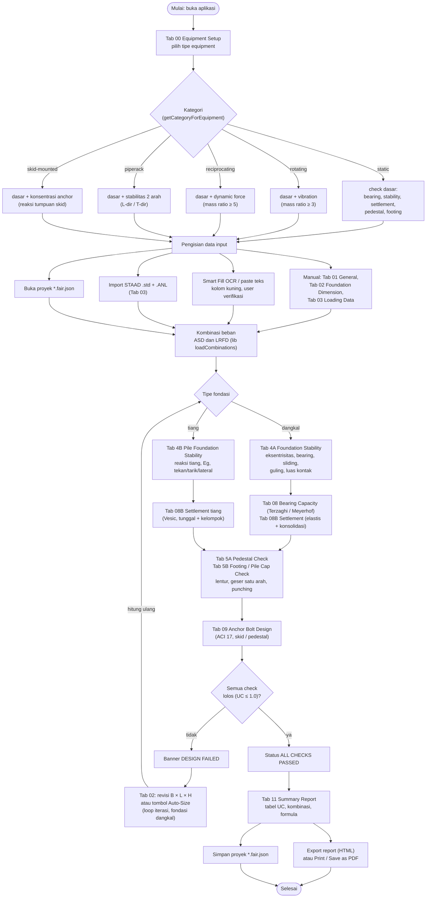
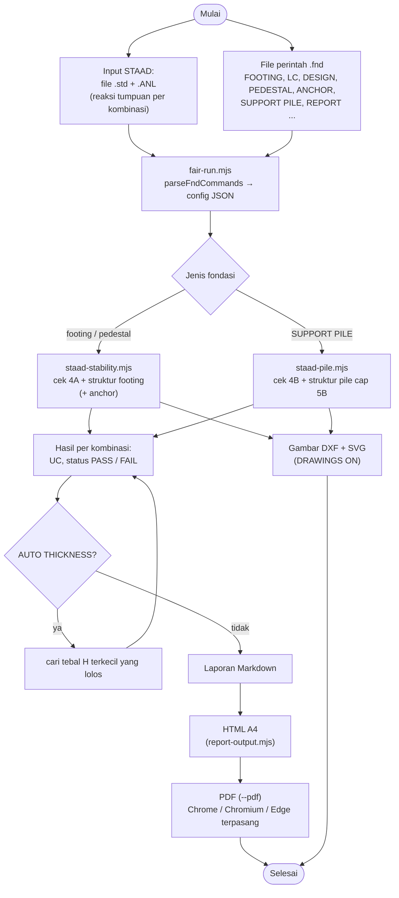

# Flowchart FAIR Foundation Design

Dua alur: (1) alur kerja di aplikasi web (urutan tab), (2) alur batch lewat CLI (`fair-run`). Diagram memakai Mermaid, tampil langsung di GitHub; versi gambar: [flowchart-aplikasi.svg](flowchart-aplikasi.svg), [flowchart-cli.svg](flowchart-cli.svg).

Sumber: `docs/PROJECT_INSTRUCTIONS.md` §3, §4, §9; `AGENTS.md` §3, §5, §6; urutan tab di `index.html`.

## 1. Alur kerja di aplikasi

Kartu perangkat (Tab 00) menentukan kategori equipment, dan kategori menentukan check yang tampil. Check 4–7 adalah loop validasi, bukan langkah linear: gagal → revisi dimensi (atau Auto-Size, fondasi dangkal) → hitung ulang sampai semua lolos.

## 2. Alur batch lewat CLI (`tools/fair-run.mjs`)

Tidak memakai UI. Rumus tetap dari `lib/foundation`; CLI hanya membaca input dan menyusun laporan. Cakupan: footing/pedestal dangkal dan pile cap; tipe equipment lain belum.

